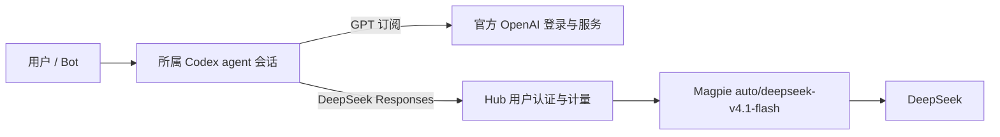

# Bot、模型与 agent

职位模板只保存职责、名称、权限、技能、例行任务和种子记忆，不绑定厂商或模型。Bot 实例分别保存 `engine`（agent）和 `model`（模型选择）。当前 GPT 与 DeepSeek 的默认 agent 都是官方 Codex CLI；不再使用 Hub 自建的 DeepSeek 会话执行器。

| 配置 | 开发版 | 内测版 |
| --- | --- | --- |
| 默认幕僚长模型 | GPT 订阅 | DeepSeek |
| 其他默认 Bot 模型 | DeepSeek | DeepSeek |
| 默认 agent | Codex 官方 CLI | Codex 官方 CLI |
| DeepSeek 路由 | `auto/deepseek-v4.1-flash` | 同一 Magpie 路由组 |
| Android 包名 | `com.wangzan101.vibelink` | `com.wangzan101.vibelink.beta` |
| Hub 数据 | `<VIBELINK_DATA>/dev` | `<VIBELINK_DATA>/beta` |

## 请求与会话



Magpie 本机模型目录实际公布的兼容 API ID 是 `auto/deepseek-v4.1-flash`；其 Responses 响应中的路由组名是 `group/auto-deepseek-v4-1-flash`。两个版本均使用该组，不要求 DeepSeek API Key。

Hub 网关默认转发到 `http://127.0.0.1:3425/v1`，可由服务端环境变量 `VIBELINK_MAGPIE_URL` 指定其他部署地址。客户端只能请求该 DeepSeek 模型的 `/responses`、`/chat/completions`，不能选择 GPT、Claude、Gemini 或其他上游。GPT 订阅始终使用官方 Codex 的 OpenAI provider 和 ChatGPT 登录，不经过 Magpie。Claude/Gemini 暂不可选；恢复时须分别使用官方 CLI。

Codex 的 DeepSeek provider 使用 Responses API，地址为 Hub 的 `/api/llm/v1`。Hub 为每轮 agent 调用签发只允许模型网关使用的短期能力 Token；该 Token 绑定已认证用户，不能用来访问会话管理或管理员接口。传给 Magpie 的身份由服务端覆盖，客户端填写的 `user` 不参与归属。开发者不需要配置两套 DeepSeek Key。

会话内容与历史文件保存在 agent 的 Codex 目录中。Hub 的 `agent_sessions.json` 只记录会话 ID、所属 agent、用户、模型、设备和标题等索引。新建、续聊、读消息和中断均使用同一个运行目录；改变模型会清除旧活动绑定，重新建立会话。旧 Hub 自建 DeepSeek 会话不会伪装成 Codex 会话继续使用。

GPT 的默认官方登录目录为 `~/.vibelink-cli/dev/codex`。DeepSeek 使用隔离的 `~/.vibelink-cli/scopes/<scope>/codex`，不复制 ChatGPT 登录信息。scope 从版本、用户身份和模型生成。内测用户的工作区、HOME、CLI 缓存与会话目录独立，工具进程不继承宿主的 Agent Token 或其他账号环境；执行采用 Codex 限制读取权限配置：文件系统默认拒绝，只开放当前工作区和最小运行库，工具网络访问关闭；只读职位的工作区仅可读。启用 `--strict-config`，旧 CLI 不得静默忽略配置。宿主无法执行限制读取策略时，创建/续聊会话或工具调用失败，不降级为宽泛读取或无沙箱。内测工作区禁止项目级 Codex 配置覆盖。生产内测可通过 `VIBELINK_BETA_AGENT_DEVICE` 选择独立主机上的工作节点；默认使用 `pc` 的隔离运行目录。远程节点需设置 `VIBELINK_MODEL_GATEWAY_URL` 为节点可达的 Hub 模型网关地址。Windows 内测明确使用 `windows.sandbox = "mxc"`，不启用自动降级。此前失败来自旧的 unelevated/elevated 后端，不代表本机无法隔离；本机 Codex 0.167.0 的 MXC 已通过工作区读写、目录外/同级用户/CLI 配置拒绝读取及本机网络拒绝连接验证。清空继承环境时保留 MXC 必需的 `SystemDrive`。不支持 MXC 的 Windows 节点会拒绝启动，可改用支持限制读取的 Linux/WSL 节点。

Hub 与 Agent 必须一起更新。新的 `codex.runtime.*` 请求会被旧 Agent 拒绝，不允许旧 Agent 忽略模型配置后意外调用 GPT 订阅。

旧 Agent 本地 Bot 定时任务缺少每次执行所需的用户绑定和新网关授权，现已暂停创建、手动运行和后台自动执行，避免回退 GPT 或绕过计量；普通 Bot 会话可正常使用。恢复自动任务前必须接入 Hub 授权续签。

## 按用户计量和限制

每位内测用户分配独立的随机邀请码和 tenant ID。多台设备使用同一账户时合并计量；多人共用邀请码也会被视为同一个账户。可预测的 `shortCode` 只用于显示，不再允许兑换 Token；已激活的客户端 Token 继续有效。

计量位于 Hub 到 Magpie 的转发处，每次真实上游调用单独记账，包含 Codex 的工具循环、上下文压缩和重试。普通 JSON 和 SSE 两种响应均解析上游 usage。记录输入、输出、缓存命中、总 token，以及成功、错误、断线次数、耗时和协议。缓存命中属于输入 token，不再次加入总量。

上游未返回 usage 时，`totalTokens` 不伪造精确数值，另外记录 `usageMissingRequests` 与保守的 `estimatedTokens`，估算量用于额度控制。请求发送前原子预占输入字节上界与输出预算，完成后按实际 usage 结算；断线或进程重启时仍结算未完成预占，避免绕过限额。统计按北京时间日期归属请求开始的那一天。

默认每个内测账户每日最多 300 次上游请求、1,500,000 实际及估算 token、12,000,000 请求输入字节，最多 2 个并发、每分钟 30 次。输入字节是 CLI 多轮重传上下文的传输保护，不能按一个字节等于一个 token 配置。管理员可分别调整；已有自定义额度不由启动迁移覆盖。开发者账户默认记录用量而不设置每日请求/token 上限，仍受并发与网关总容量限制。达到 80% 返回 `near_limit`，达到额度返回 `exhausted`；超额、超并发或超频率在发给 Magpie 前返回 429。

账本位于 Hub 数据目录的 `model_usage.json`，保存日汇总、限额、未完成预占和最近请求审计。审计不保存提示词、回答、Authorization 或任何 Token。旧版本已消耗的内测请求/输入额度会导入，未记录过的历史 token 明确作为估算处理。

| 接口 | 权限和用途 |
| --- | --- |
| `GET /api/usage` | 用户自己的今日用量 |
| `GET /api/beta/quota` | 兼容手机端，使用同一本账本 |
| `GET /api/usage/users?day=2026-11-08` | 管理员按用户查看指定日期汇总与警戒状态 |
| `GET /api/usage/requests` | 管理员查看最近请求、耗时、状态和 usage 是否缺失 |
| `POST /api/usage/limits` | 管理员调整某个账户的额度 |
| `GET /api/beta/tenants` | 原席位管理接口，同步展示实际计量值 |

修改额度的 JSON 示例（仍需管理员认证）：

```json
{
  "userId": "beta_01",
  "limits": {
    "dailyRequests": 300,
    "dailyTokens": 1500000,
    "dailyInputBytes": 12000000,
    "concurrentRequests": 2,
    "requestsPerMinute": 30
  }
}
```

## 验证

Rust 测试覆盖用户隔离、限额预占、并发、重启恢复、UTC+8 换日、JSON/SSE usage、身份防伪、仅模型能力 Token 和实际 agent 会话绑定。`gateway_smoke` 是默认不运行的真实调用测试，读取 `VIBELINK_CODEX_SMOKE_REQUEST` 指定的临时请求文件。已在临时 Hub 上通过生产 Agent 处理函数验证开发版 DeepSeek 的官方 Codex 新建与续聊：同一 session 两轮，2 次真实请求，20,037 tokens（输入 20,033、输出 4、缓存命中 13,824），缺失 usage 为 0。内测 MXC 已另行验证真实新建与续聊，以及读写职位和只读职位的文件边界。临时 Hub 已停止。

Android 开发版与内测版分别验证模型策略、订阅入口和更新分版相关 24 项测试，并构建独立包名的 1.5.3 APK；全量测试在上次运行时仍有既有 Windows/POSIX、资源与功能断言失败，不宣称全量测试通过。

依据：[OpenAI 自定义 provider 配置](https://learn.chatgpt.com/docs/config-file/config-advanced)、[配置参考](https://learn.chatgpt.com/docs/config-file/config-reference)、[权限配置](https://learn.chatgpt.com/docs/permissions)，以及本机 Magpie `/v1/models` 与真实 Responses 调用。


## Windows 运行部署

开发 Hub（18995）和内测 Hub（18998）分别连接独立 Agent 进程。内测 Agent 使用独立的 Hub agent Token，以 `--beta-worker` 启动，使用独立单实例互斥体，只接收带内测 DeepSeek 运行时绑定的 Codex 请求，不启动开发者本地定时任务或共用二进制的自动更新线程。内测 Codex 使用 `--no-daemon`，避免共享后台服务状态。看门狗分别识别两个 Agent，避免其中一个存在时漏掉另一个。

升级前备份原二进制、启动脚本和两个版本的数据；旧开发数据导入 `data/dev`，旧内测数据导入 `data-beta/beta`，保留各自邀请码、已激活 Token、Bot 和累计额度。不得将开发者凭据导入内测。部署完成后核对二进制 SHA-256、两个 Hub 健康、两个 Agent 心跳和真实内测会话 usage。

MXC 依据：[官方 Windows 沙箱说明](https://learn.chatgpt.com/docs/windows/windows-sandbox)。显式 `mxc` 配置在宿主不支持时失败，不能改为 `prefer_mxc` 后允许回落到旧后端。


2026-11-08 已在 PC 部署：开发/内测 Hub 均健康，分别连接 Agent 0.2.9；公网手机入口健康检查通过。生产内测临时用户的新建和同会话续聊共 2 次上游请求，输入 20,945、输出 4、总量 20,949、缓存命中 14,080 tokens，usage 缺失为 0，跨用户读取被拒绝；验证凭据已撤销。带 MXC 读写/只读/原生 curl 网络探针的集成测试另行通过。旧程序、配置和原数据备份在运行目录的 `backups/runtime-20261108-051158`。

Mac 上原有 Agent 已在隔离源码目录完成 17 项测试与 release 编译，替换为 0.2.9，使用独立 agent 凭据，Hub 心跳确认在线；原二进制和启动脚本保留于 `~/src/vibelink-upgrades/20261108-mxc/`。

## 1.5.4：手机模型绑定与实机验证

群聊顶栏的“模型”可以按成员选择 GPT 或 DeepSeek；内测只有 DeepSeek。修改先写入本地持久化待同步队列，Hub 确认前不创建 Agent 会话；同步失败保留选择，下次重试。并发的新编辑不会被旧请求的确认或后续拉取覆盖。切回 GPT 时显式发送空模型值，防止继续沿用旧 DeepSeek 绑定。职责模板重置保留已有模型、设备、目录和会话。

首页不启动 Mika 配置；用户打开 Mika 会话后才进入必要配置。助手默认名为 Mika，应用名保持 VibeLink。建会话失败展示实际错误，未配对时提示配置 Hub 并完成配对。

2026-11-08 两版各 39 项定向 Android 测试、Hub 24 项测试通过，1.5.4（versionCode 87）独立包名 APK 已发布，签名与旧版一致，均未打包 YAML 配置。开发版清单与下载使用内网 Hub，内测使用公网 Hub；均已验证实际下载返回 APK。两处运行 Hub 已逐个替换，PC/Mac Agent 心跳正常。

真实携带 Bot 身份的调用覆盖官方 GPT 回复、修改绑定后 DeepSeek 回复和同一会话续聊、再切回 GPT。DeepSeek 两次请求实际计量 24,134 tokens，usage 无缺失；临时 Bot 和验证凭据已清理。OnePlus Ace 3 Pro 实机验证开发版覆盖安装、群聊模型入口、新装内测直接进入首页、内测模型列表只有 DeepSeek。该手机尚未配对电脑，因此实机群聊端到端回复仍需扫码配对后验证，不能以通用会话测试代替。

最终文字修订升级为 1.5.5（versionCode 88）：Mika 欢迎页和中英文对话提示统一助手名称；应用与项目仍称 VibeLink。额外加入英文界面回归检查，两版各 42 项定向测试通过。运行 Hub 更换后再次验证真实内测新建/续聊：2 次请求、20,956 tokens、usage 无缺失，跨用户读取仍被拒绝。
