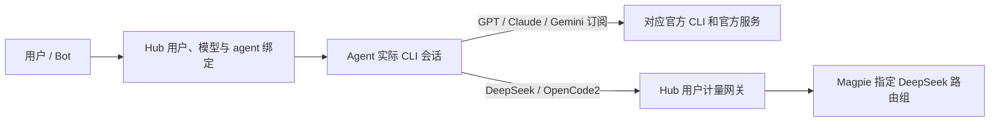

# Bot、模型与 agent

职位模板只保存职责、名称、权限、技能、例行任务和种子记忆，不绑定厂商或模型。Bot 实例分别保存 `engine`（实际 CLI 运行器）和 `model`（模型选择）。安装、登录是否完成属于运行状态，不决定产品支持范围。

| 模型 | 实际 agent | 开发版 | 内测版 |
| --- | --- | --- | --- |
| GPT 订阅 | 官方 Codex CLI | 默认幕僚长 | 不开放 |
| DeepSeek | OpenCode2 CLI（v2） | 其他默认 Bot | 全部默认 Bot |
| Claude 订阅 | 官方 Claude Code CLI | 可选 | 不开放 |
| Gemini 订阅 | 官方 Gemini CLI | 可选，需安装并登录 | 不开放 |

DeepSeek 使用 Magpie API ID `auto/deepseek-v4.1-flash`，对应组 `group/auto-deepseek-v4-1-flash`；开发版、内测版共用该组，不要求 DeepSeek API Key。GPT、Claude、Gemini 的订阅请求由各自官方 CLI 直连其官方服务，不经 Magpie 或兼容反代。

## 请求与会话



`agent_sessions.json` 是 Hub 的用户、设备、模型和运行器索引；原生会话由实际 CLI 保存。OpenCode2 以 `--standalone` 使用独立服务和配置，不使用个人共享 OpenCode 服务。其 v2 `providers` 配置只启用 `vibelink`，主模型、辅助模型均指向同一组，所有请求进入 `/api/llm/v1` 后计量。

改变模型或 agent 后新建活动绑定，原历史归原运行器保留。此前 DeepSeek/Codex 历史可读，不用 OpenCode2 伪装续接；UI 同时展示实际模型和 agent，并能从 Bot 资料页编辑。迁移只修正运行器绑定，不重置用户职位、技能和记忆。

GPT 官方目录为 `~/.vibelink-cli/dev/codex`。Claude 官方订阅目录为 `~/.vibelink-cli/dev/claude`，桌面登录、状态检查、会话与 Agent 共用此目录；不读取或复制个人 `~/.claude/settings.json` 的代理凭据。其他原生 CLI 的会话/缓存目录按实际运行器、身份和模型分开。

Hub 与 Agent 必须同时更新。新 `cli.runtime.*` RPC 由新 Agent 识别；旧 Agent 不得忽略模型或运行器后回退 GPT。模型绑定的旧例行任务仍明确暂停，不会丢失模型后回退 GPT；恢复调度前必须由 Hub 每次携带绑定信息和短期模型凭据。用户显式发起的群 Work 已验证实际执行、交付及重启续聊。

## 内测执行隔离

内测 DeepSeek 使用 WSL Ubuntu 中的真实 Linux OpenCode2 和 bubblewrap。每个 scope 分配独立 OS UID、HOME、工作区和数据目录；用户、挂载、PID、网络命名空间隔离。仅挂载当前 scope、最小运行库和当前作业的 Unix 模型桥；宿主 `/mnt/c`、个人 HOME、其他 scope、Windows 订阅凭据不可见。只读职位禁止写工作区，且不提供 edit/shell/subagent/execute 工具。

CLI 网络只允许经过当前作业的模型桥；真实 Hub 模型 grant 保留在受信代理侧，CLI 仅接触占位凭据。内测不能获得宿主交互 shell、Root 终端或管理员 Hub Token。取消和重启后的状态要由 Linux 作业状态确认，不能把 Windows `wsl.exe` 退出当作进程树已结束。隔离工作节点不可用时报告真实错误，不改用开发者目录。

## 程序内 CLI

桌面复用 node-pty 与 xterm，把真实交互 CLI 嵌在应用界面，支持键入、可见尺寸调整、Ctrl+C、关闭和重开。Renderer 只发送固定 agent 与 chat/login 意图，不提供可执行路径、任意参数或环境。Main 校验受信窗口及当前开发版登录 epoch，解析 CLI；账号切换/退出/过期后关闭旧终端。内测继续在隔离工作节点执行，不开放宿主 shell。

当前内嵌原生终端是独立会话，不冒充 Hub Bot 原生会话的接管。DeepSeek 通过仅开发版 `POST /api/cli/launch-grant` 获取两小时模型专用凭据；该凭据不能访问 Bot、会话、管理员接口，也不能自续。主进程持有客户端凭据，CLI 只获得模型 grant；显式重开重新签发 grant，绝不回退客户端或管理员 Token。

实现参考 [Orca 终端](https://github.com/stablyai/orca/tree/main/src/renderer/src/components/terminal-pane) 的可见 resize、先订阅后启动及生命周期处理。本批复用本项目现有 PTY/xterm，没有复制 Orca 源码。

## 按用户计量和限制

每位内测用户分配独立的随机邀请码和 tenant ID。多台设备使用同一账户时合并计量；多人共用邀请码也会被视为同一个账户。可预测的 `shortCode` 只用于显示，不再允许兑换 Token；已激活的客户端 Token 继续有效。

计量位于 Hub 到 Magpie 的转发处，每次真实上游调用单独记账，包含 Codex 的工具循环、上下文压缩和重试。普通 JSON 和 SSE 两种响应均解析上游 usage。记录输入、输出、缓存命中、总 token，以及成功、错误、断线次数、耗时和协议。缓存命中属于输入 token，不再次加入总量。

上游未返回 usage 时，`totalTokens` 不伪造精确数值，另外记录 `usageMissingRequests` 与保守的 `estimatedTokens`，估算量用于额度控制。请求发送前原子预占输入字节上界与输出预算，完成后按实际 usage 结算；断线或进程重启时仍结算未完成预占，避免绕过限额。统计按北京时间日期归属请求开始的那一天。

默认每个内测账户每日最多 300 次上游请求、1,500,000 实际及估算 token、12,000,000 请求输入字节，最多 2 个并发、每分钟 30 次。输入字节是 CLI 多轮重传上下文的传输保护，不能按一个字节等于一个 token 配置。管理员可分别调整；已有自定义额度不由启动迁移覆盖。开发者账户默认记录用量而不设置每日请求/token 上限，仍受并发与网关总容量限制。达到 80% 返回 `near_limit`，达到额度返回 `exhausted`；超额、超并发或超频率在发给 Magpie 前返回 429。

账本位于 Hub 数据目录的 `model_usage.json`，保存日汇总、限额、未完成预占和最近请求审计。审计不保存提示词、回答、Authorization 或任何 Token。旧版本已消耗的内测请求/输入额度会导入，未记录过的历史 token 明确作为估算处理。

| 接口 | 权限和用途 |
| --- | --- |
| `GET /api/usage` | 用户自己的今日用量 |
| `GET /api/beta/quota` | 兼容手机端，使用同一本账本 |
| `GET /api/usage/users?day=2026-11-08` | 管理员按用户查看指定日期汇总与警戒状态 |
| `GET /api/usage/requests` | 管理员查看最近请求、耗时、状态和 usage 是否缺失 |
| `POST /api/usage/limits` | 管理员调整某个账户的额度 |
| `GET /api/beta/tenants` | 原席位管理接口，同步展示实际计量值 |

修改额度的 JSON 示例（仍需管理员认证）：

```json
{
  "userId": "beta_01",
  "limits": {
    "dailyRequests": 300,
    "dailyTokens": 1500000,
    "dailyInputBytes": 12000000,
    "concurrentRequests": 2,
    "requestsPerMinute": 30
  }
}
```

## 验证与历史记录

本次 CLI 迁移的 Rust、Android、内嵌终端及真实推理验证随发布记录更新；实际 token 与上游缺失时的估算量分别报告。没有连接 ADB 的手机不宣称实机验证通过。

以下段落保留较早版本的部署记录，描述的是当时实现，不作为当前运行器策略。

## Windows 运行部署

开发 Hub（18995）和内测 Hub（18998）分别连接独立 Agent 进程。内测 Agent 使用独立的 Hub agent Token，以 `--beta-worker` 启动，使用独立单实例互斥体，只接收带内测 DeepSeek 运行时绑定的 Codex 请求，不启动开发者本地定时任务或共用二进制的自动更新线程。内测 Codex 使用 `--no-daemon`，避免共享后台服务状态。看门狗分别识别两个 Agent，避免其中一个存在时漏掉另一个。

升级前备份原二进制、启动脚本和两个版本的数据；旧开发数据导入 `data/dev`，旧内测数据导入 `data-beta/beta`，保留各自邀请码、已激活 Token、Bot 和累计额度。不得将开发者凭据导入内测。部署完成后核对二进制 SHA-256、两个 Hub 健康、两个 Agent 心跳和真实内测会话 usage。

MXC 依据：[官方 Windows 沙箱说明](https://learn.chatgpt.com/docs/windows/windows-sandbox)。显式 `mxc` 配置在宿主不支持时失败，不能改为 `prefer_mxc` 后允许回落到旧后端。


2026-11-08 已在 PC 部署：开发/内测 Hub 均健康，分别连接 Agent 0.2.9；公网手机入口健康检查通过。生产内测临时用户的新建和同会话续聊共 2 次上游请求，输入 20,945、输出 4、总量 20,949、缓存命中 14,080 tokens，usage 缺失为 0，跨用户读取被拒绝；验证凭据已撤销。带 MXC 读写/只读/原生 curl 网络探针的集成测试另行通过。旧程序、配置和原数据备份在运行目录的 `backups/runtime-20261108-051158`。

Mac 上原有 Agent 已在隔离源码目录完成 17 项测试与 release 编译，替换为 0.2.9，使用独立 agent 凭据，Hub 心跳确认在线；原二进制和启动脚本保留于 `~/src/vibelink-upgrades/20261108-mxc/`。

## 1.5.4：手机模型绑定与实机验证

群聊顶栏的“模型”可以按成员选择 GPT 或 DeepSeek；内测只有 DeepSeek。修改先写入本地持久化待同步队列，Hub 确认前不创建 Agent 会话；同步失败保留选择，下次重试。并发的新编辑不会被旧请求的确认或后续拉取覆盖。切回 GPT 时显式发送空模型值，防止继续沿用旧 DeepSeek 绑定。职责模板重置保留已有模型、设备、目录和会话。

首页不启动 Mika 配置；用户打开 Mika 会话后才进入必要配置。助手默认名为 Mika，应用名保持 VibeLink。建会话失败展示实际错误，未配对时提示配置 Hub 并完成配对。

2026-11-08 两版各 39 项定向 Android 测试、Hub 24 项测试通过，1.5.4（versionCode 87）独立包名 APK 已发布，签名与旧版一致，均未打包 YAML 配置。开发版清单与下载使用内网 Hub，内测使用公网 Hub；均已验证实际下载返回 APK。两处运行 Hub 已逐个替换，PC/Mac Agent 心跳正常。

真实携带 Bot 身份的调用覆盖官方 GPT 回复、修改绑定后 DeepSeek 回复和同一会话续聊、再切回 GPT。DeepSeek 两次请求实际计量 24,134 tokens，usage 无缺失；临时 Bot 和验证凭据已清理。OnePlus Ace 3 Pro 实机验证开发版覆盖安装、群聊模型入口、新装内测直接进入首页、内测模型列表只有 DeepSeek。该手机尚未配对电脑，因此实机群聊端到端回复仍需扫码配对后验证，不能以通用会话测试代替。

最终文字修订升级为 1.5.5（versionCode 88）：Mika 欢迎页和中英文对话提示统一助手名称；应用与项目仍称 VibeLink。额外加入英文界面回归检查，两版各 42 项定向测试通过。运行 Hub 更换后再次验证真实内测新建/续聊：2 次请求、20,956 tokens、usage 无缺失，跨用户读取仍被拒绝。
